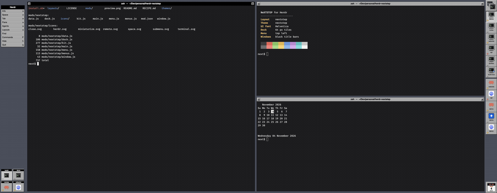
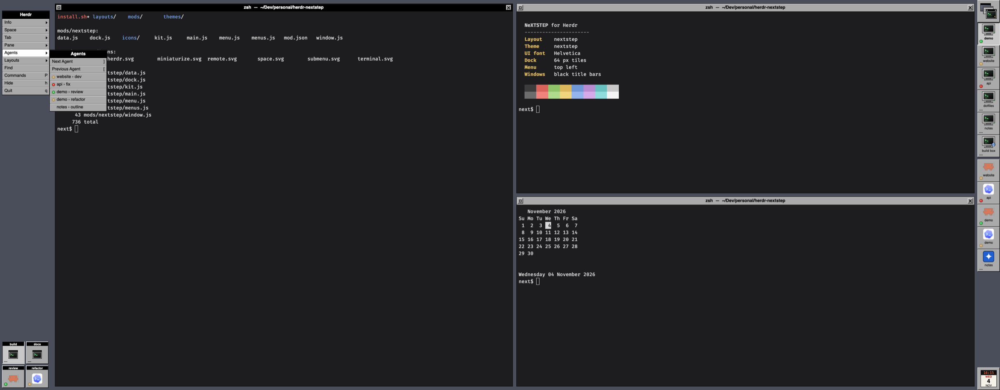

# herdr-nextstep

A NeXTSTEP desktop for the [Herdr](https://herdr.dev) desktop app: the menu at the top left, the Dock down the right edge, and your panes as windows with black title bars.





- **The menu** holds Herdr's commands. Info, Space, Tab, Pane, Agents and Layouts open submenus beside it, and your Cmd shortcuts show as key equivalents.
- **The Dock** has one 64px tile per space and one per agent. A tile with nothing going on shows NeXT's "...". A light shows what an agent is doing: amber pulsing while it works, red blinking when it needs you, green when it's done. Click a space to show it or an agent to focus it, and right-click a space for its menu. The clock sits at the bottom.
- **Miniwindows** in the bottom-left corner are the shown space's tabs. Click one to show it.
- **Panes are windows.** The one with the keyboard has a black title bar and the others are gray. The left button miniaturizes the tab and the right one closes the pane. Double-click a title bar to zoom.

Everything Herdr does still works: spaces, tabs, splits, agents and their statuses, and your own keys.

## Install

```sh
git clone https://github.com/cunderw/herdr-nextstep
./herdr-nextstep/install.sh
herdr-app do layout.switch --name nextstep
```

`install.sh` copies the layout, its theme and the `nextstep` mod into `~/.config/herdr-app`, because a symlinked mod folder doesn't draw its icons. Run it again after pulling. `layout.switch` (`ctrl-shift-l` by default) cycles back to your own layout.

The UI is set in Helvetica, which macOS ships. No fonts are bundled. Elsewhere Herdr picks a fallback font, so the menus won't look quite as NeXT. Terminals keep your own font from `settings.json`.

## What it touches

Nothing outside Herdr. It runs no programs, reads no files and makes no network requests. It only reads Herdr's spaces, tabs, panes and agents, and runs Herdr commands when you click.

[RECIPE.md](RECIPE.md) has the full brief. All the art is original SVG drawn for this layout.
