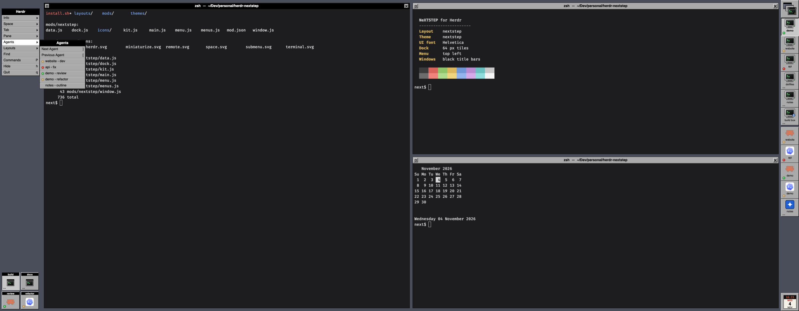

# NeXTSTEP

Herdr as a NeXTSTEP 3 desktop. A dark slate workspace holds the vertical main menu at the top left and the shown space's tabs as miniwindows in the bottom-left corner. Down the right edge runs the Dock: a tile per space, a tile per agent, and a clock. Panes are windows with black or gray title bars, white centred titles, and miniaturize and close buttons. Everything is gray `#aaaaaa` with 1px white and dark bevels, set in Helvetica.

## What you see

Left to right, at zoom 1:

- **Workspace column**, 148px wide, on the slate root background `#4a4e5a`. It drags the window.
  - A 30px empty strip at the top, where the macOS window buttons sit (`traffic_lights: [14, 10]`). Where the system draws no window buttons, the strip holds a NeXT miniaturize button on the left and a close button on the right.
  - **The main menu**, 136px wide and 6px in from the left, with a 1px black outline:
    - a 23px black title bar, "Herdr", in 12.5px bold white, centred;
    - ten 22px cells: Info ▸, Space ▸, Tab ▸, Pane ▸, Agents ▸, Layouts ▸, Find, Commands, Hide, Quit. On Linux and Windows the last two are Miniaturize and Close.
    - Each cell is `#aaaaaa` with a white top-left and `#555555` bottom-right hairline, a 12px black label 5px in, and on the right either a 6×9px black ▸ or the key equivalent. The cell whose submenu is open turns white.
    - A key equivalent is the letter of a `cmd-<key>` binding in `keys.json` (`global` or `layout:nextstep`), upper case for `cmd-shift-<key>`. Other chords show nothing.
  - **Miniwindows**, at the bottom-left, 6px from the bottom: one per tab of the shown space, two to a row with 4px gaps, filling upward. Each is a 64px tile:
    - an 11px black strip with the tab's name (or "Tab 2") in 8.5px bold white;
    - a 30px icon, which is the program icon of the tab's agent, else its focused pane's program, else the terminal art;
    - the status corner (below).
    - The shown tab is sunken, with a `#c8c8c8` face. A settled tab's icon is drawn at 45% opacity.
- **Windows**: the shown tab's panes, with 10px vertical and 8px horizontal padding and 10px gaps of slate between them. Each pane has a 1px black border and a `#1d1d1f` background. The 22px title bar on top looks like this:
  - Black with a `#3a3a3a` top hairline and white text for the pane with the keyboard. Every other pane's bar is `#aaaaaa` with a white top hairline and black text.
  - The title is 12.5px bold Helvetica, centred: `Program  —  ~/folder`. A shell shows the title its program set, or the shell's name when the title is only the terminal's address.
  - An 8px status light sits before the title of an agent pane.
  - A 15px bevelled miniaturize button (a hollow square) is on the left, and a close button (an X) is on the right, each centred in a 22px slot.
- **The Dock**, 64px wide, flush with the right edge. It also drags the window.
  - At the top is Herdr's tile: three overlapping NeXT windows, the front one a terminal, at 52px.
  - Then one tile per space. Each has a 40×34px CRT monitor with a green prompt (a monitor with a blue globe for a space on another machine), and the space's name in 9.5px. The shown space is sunken, with a `#c8c8c8` face and a bold name.
  - A 6px slate gap follows, then one tile per agent: the program icon from Herdr's table at 32px and the agent's space name. A one-colour icon is drawn on its `tile` colour in its `color`. The focused agent's tile is sunken.
  - The list scrolls when it is taller than the window.
  - At the bottom is the clock: a 46×48px cream page `#f4f1e8` with a black strip showing the time in Menlo 10px `#ff6a3d`, the day in 8px bold `#b0281e`, the date in 16px bold and the month in 8px.
  - Every tile is 64px square, bevelled with a black outer and `#555555` inner bottom-right, a white top-left and an `#aaaaaa` face. Tiles abut with no gaps, as in NeXT's Dock.
- **Submenus** open as popups beside the main menu. The top of the submenu lines up with the item that opened it. Each has a 23px black title bar with the submenu's name and 22px cells. The width is 7px per character plus 44px, between 128px and 260px.
  - Info: Settings..., Help, What's New, Check for Updates.
  - Space and Tab: New, Rename..., Next, Previous, then Close. Tab also has Miniaturize.
  - Pane: Split Right, Split Down, Zoom, Close.
  - Agents: Next Agent, Previous Agent, then every agent as `space › tab` with its status light.
  - Layouts: every layout, with the shown one white.
- The theme `themes/nextstep.json` gives terminals `#1d1d1f` with `#d8d8d8` text, a `#5a5f6b` selection and a muted 16-colour palette. Herdr's own dialogs and toasts are gray `#aaaaaa` with black text and black accents. Terminals keep the person's own font.

## How it behaves

- **Status corner** of every Dock tile and miniwindow, 4px in from the bottom-left:
  - working: an amber `#f2b233` 9px light pulsing between 35% and 100% opacity every 1.4s;
  - blocked: a red `#ef3b2d` light blinking between 15% and 100% every 0.6s;
  - done: a steady green `#3fcf52` light;
  - idle, or no agent at all: NeXT's "...", three 2px black squares 2px apart.
  - A space's and a tab's light is its most urgent agent's (blocked > done > working > idle). All lights animate natively with `.loop("opacity")`.
- **Clicks**:
  - Herdr's tile opens the command palette.
  - A space tile shows that space, and right-clicking it opens its Space submenu at the pointer.
  - An agent tile focuses that agent, in whatever space it is.
  - A miniwindow shows its tab, and right-clicking it opens its Tab submenu at the pointer.
  - In a title bar, a click focuses the pane, a double-click zooms it, miniaturize settles the tab, and close closes the pane.
- **Menus**:
  - A press on a ▸ item opens its submenu. Opening another submenu closes the first.
  - Choosing a submenu item closes the submenu and runs the command. A press outside it or Escape closes it.
  - Plain items (Find, Commands, Hide, Quit) run on click.
  - Rename... and Close ask through Herdr's own dialogs.
- Agent order: the Dock calls `setAgentOrder` with its agent tiles, so `agent.next` and `agent.prev` follow the Dock.
- The clock redraws every minute. Nothing else uses a timer.

## Built from

- `layouts/nextstep.json`, a root `row` with `resizable: false`, `background: "#4a4e5a"`, `theme: "nextstep"`, `ui_font: "Helvetica"`, `terminal_padding: [6, 4]`, `terminal_opacity: 1`, `titlebar: "none"`, `traffic_lights: [14, 10]` and `preview: "layouts/nextstep.png"`. It has three children:
  - `workspace`: a block, 148px, `window_drag`, with `{ mod: "nextstep", props: { role: "menu" } }`;
  - `main`: `{ tab: "active", pane: { header: { content: { mod: "nextstep", props: { role: "window" } }, reveal: "always", height: 22, position: "top" }, background: "#1d1d1f", border: { width: 1, color: "#000000" }, focus: the same, radius: 0, gap: 10, lone: true } }` with `padding: [10, 8]`;
  - `dock`: a block, 64px, `window_drag`, with `{ mod: "nextstep", props: { role: "dock" } }`.
- One mod, `mods/nextstep/`, with `mod.json` `{ "place": "none" }`. `main.js` picks a role from `props().role`:
  - `menu` (`menu.js` `MenuColumn`): the strip, the main menu and the miniwindows;
  - `submenu` (`menu.js` `Submenu`): a popup, props `{ role, kind, target }`;
  - `dock` (`dock.js`);
  - `window` (`window.js`): the pane header, which reads its own pane from `panes()` with `props().pane`.
- Shared code:
  - `kit.js`: the palette, bevels, tiles, title bars, lights and the ellipsis;
  - `menus.js`: what each menu holds, and key equivalents from `keys()`;
  - `data.js`: the one place `spaces()`, `agents()` and `panes()` are read.
- A submenu is `openOverlay({ mod: "nextstep", kind: "popup", frame: "none", width, height, at: { x: bounds.x + bounds.width, y: bounds.y }, props })`. The bounds come from the cell's `on_mouse_down` event. The open submenu is kept in shared `"nextstep.sub"` (`{ kind, id, target }`), so the menu copy can highlight its item. The popup clears that key in its `close()`.
- Herdr functions: `props`, `spaces`, `agents`, `panes`, `focused`, `layouts`, `keys`, `shared`, `setShared`, `setAgentOrder`, `settings`, `window`, `home`, `openOverlay`, `closeOverlay`, `run`.
- Commands: `space.select`, `space.new`, `space.rename`, `space.next`, `space.prev`, `space.close`, `tab.select`, `tab.new`, `tab.rename`, `tab.next`, `tab.prev`, `tab.settle`, `tab.close`, `pane.split`, `pane.zoom`, `pane.close`, `pane.focus`, `agent.focus`, `agent.next`, `agent.prev`, `layout.switch`, `terminal.search`, `app.palette`, `app.settings`, `app.help`, `app.whats_new`, `app.check_updates`, `app.hide`, `app.quit`, `window.minimize`, `window.close`.
- It runs no programs, reads no files and fetches nothing.
- Art, all original SVG in `mods/nextstep/icons/`:
  - full colour with `image()`: `herdr.svg` (stacked windows), `space.svg` (a CRT monitor), `remote.svg` (the monitor with a globe), `terminal.svg` (a terminal window);
  - one colour, tinted with `svg()`: `miniaturize.svg`, `close.svg`, `submenu.svg`.
  - Agent icons are Herdr's own program table.
- `install.sh` copies the mod folder, the layout and `themes/nextstep.json`. It also copies `preview.png` to `layouts/nextstep.png`, where the layout's `preview` points.

## Watch out

- Install by copying. A symlinked mod folder loads its JavaScript but draws no SVGs.
- `herdr-app check mods/nextstep` renders the mod with no props, so it only proves the role-less fallback. To check each role, check a scratch copy whose `main.js` forces `role` to `menu`, `dock`, `window` and `submenu` in turn. Check has no spaces or agents, so the tiles are only proven live.
- Popups outlive their layout. A submenu left open while the layout switches stays on screen over the next layout, and the copy that opened it is gone. Choosing Layouts ▸ closes it first, but a `layout.switch` from a key or a script does not. Close a stray one with `overlay.close`.
- Bounds and `at` are window px (zoom applied), while the overlay's `width` and `height` are layout px (Herdr applies zoom). Don't scale the bounds.
- Copies of the mod share no module state. The menu copy learns which submenu is open only through shared `"nextstep.sub"`.
- Window-drag blocks take every press. Every tile, cell and title-bar button stops propagation in `on_mouse_down("left")`, or a click drags the window instead.
- Bevel lines are `1 / zoom` px, so they stay one device pixel at any zoom.
- 64px tiles mean about 16 tiles fit in a 1100px window. More spaces and agents than that scroll, and the clock stays pinned at the bottom.
- Helvetica isn't bundled, because its licence doesn't allow redistribution. macOS has it. Elsewhere Herdr picks a fallback font. A Helvetica-like face with a licence that allows it (TeX Gyre Heros, Liberation Sans) could be bundled in `fonts/`.
- NeXT's resize bar along a window's bottom isn't drawn: a pane gets only one header.
- Miniaturize settles the tab. Settled tabs stay in the miniwindows, dimmed, and clicking one shows it again.
- Pressing an open submenu's ▸ item again is meant to close it, but the popup's own outside-press dismissal runs first, and the order hasn't been checked live.
- Key equivalents only show `cmd-<key>` bindings, as NeXT showed only Command keys.

## Done when

- `herdr-app check` passes for the mod, and for a scratch copy forced to each role.
- After `layout.switch {name: "nextstep"}`, `herdr-app status` shows no errors and there is no `layouts/nextstep.error`.
- A shot shows the main menu at the top left, the Dock on the right with a tile per space and per agent, the clock at the bottom, and the tab miniwindows bottom-left.
- A working agent's tile has a pulsing amber light, and an idle space shows "...".
- A tab split into two or more panes shows NeXT title bars: black for the focused pane, gray for the others.
- Pressing Agents ▸ opens a submenu beside the menu, top-aligned with the item, listing every agent with its light.
- Clicking a space tile shows that space, and clicking an agent tile focuses that agent.
